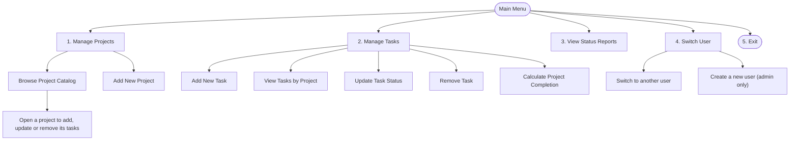
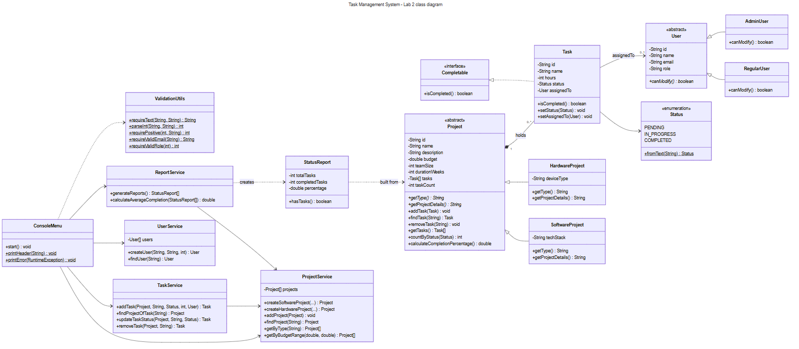

# Task Management System (Lab 2)

A console project and task manager in Java 21. You can create projects, add tasks, give them to users, change their status and see how complete each project is.

This lab continues Lab 1. The features are the same. What changed is the code: it was cleaned up, invalid input now throws custom exceptions instead of crashing, the main logic has JUnit 5 tests, and the work is tracked with Git branches.

Data is still kept in memory in arrays, so nothing is saved when the program closes.

## Contents

1. [What changed from Lab 1](#what-changed-from-lab-1)
2. [How to run](#how-to-run)
3. [Running the tests](#running-the-tests)
4. [Using the program](#using-the-program)
5. [Exceptions](#exceptions)
6. [Roles](#roles)
7. [Class diagram](#class-diagram)
8. [Features and user stories](#features-and-user-stories)
9. [Git workflow](#git-workflow)
10. [Project structure](#project-structure)

## What changed from Lab 1

- **Exceptions:** methods used to return `null` or `false` when something was wrong. Now they throw custom exceptions (`utils/exceptions`) with a clear message.
- **Validation:** in Lab 1, `ValidationUtils` read the keyboard and looped. Now it only holds the rules and throws `InvalidInputException`. `ConsoleMenu` reads the input and uses try-catch to ask again.
- **Menus:** every menu loop has a try-catch, so an error shows a message and the menu keeps working.
- **Users:** users were stored inside `ConsoleMenu`. Now `UserService` keeps them and checks the email and the role.
- **Printing:** services used to print tables. Now the services only do the work, and all printing is in `ConsoleMenu`, with small utility methods (`printHeader`, `printError`, `printSuccess`, `formatPercent`).
- **IDs:** IDs are now text like `PRJ001`, `TSK001` and `U001`, created by the services.
- **Empty projects:** a project with no tasks used to show 0%. Now `calculateCompletionPercentage()` throws `EmptyProjectException`, the tables show N/A, and the average skips it.
- **Tests:** there were none. Now there are 30 in `test/`.

More details are in [design-decisions.md](docs/design-decisions.md).

## How to run

You need JDK 21 and IntelliJ IDEA.

In IntelliJ:

1. Open the project folder.
2. Click **Load Maven Project** when IntelliJ asks. This adds JUnit 5.
3. Make sure the project SDK is JDK 21.
4. Run `Main`.

If the box characters or ✓ / ❌ show as question marks, add `-Dstdout.encoding=UTF-8` to the VM options of the run configuration.

From a terminal:

```bash
javac -encoding UTF-8 -d out $(find src -name "*.java")
java -Dstdout.encoding=UTF-8 -cp out Main
```

You start as **Admin**. **Josephus Mupanda (Regular)** also exists, and five sample projects are loaded.

## Running the tests

In IntelliJ, right click the `test` folder and choose **Run 'All Tests'**. Or run `mvn test`.

You should get 30 tests passing.

| Test class | What it tests |
|---|---|
| `ProjectTests` | completion % (the lab's example test, no tasks, all completed, rounding), generated IDs, unique IDs, positive budget, unknown project, average completion (75% and 50% give 62.5%) |
| `TaskTests` | adding a task, duplicate name, negative hours, status update and progress, `TaskNotFoundException`, removing a task |
| `ValidationTests` | empty text, letters for numbers, negative numbers, menu range, task status, IDs, email and role validation |

## Using the program



When the program asks for an ID you can type `PRJ001` or just `1`. Where the prompt says so, `0` cancels.

A wrong value shows the error and the question is asked again:

```
Enter project ID (or 0 to cancel): P999
❌ Error: ProjectNotFoundException – Project ID 'P999' does not exist.
Please try again.

Enter project ID (or 0 to cancel): 1

✓ Project 'Budget Buddy' loaded successfully.
```

If an operation cannot continue, you go back to the menu:

```
Enter task ID: T999
❌ Error: TaskNotFoundException – Task 'T999' was not found in the project.

Operation aborted. Returning to task menu...
```

## Exceptions

| Exception | When |
|---|---|
| `InvalidInputException` | wrong value: letters for a number, empty text, option not in the menu, unknown status, bad email or role |
| `InvalidProjectDataException` | negative budget, empty name, project ID or name already used (it extends `InvalidInputException`) |
| `ProjectNotFoundException` | no project with that ID |
| `TaskNotFoundException` | no task with that ID |
| `EmptyProjectException` | completion asked for a project with no tasks |

Where they are caught:

- **Typing mistakes:** the read methods in `ConsoleMenu` (`readChoice`, `readText`...) catch `InvalidInputException`, show the error and ask again.
- **Failed operations:** each menu loop in `ConsoleMenu` has a try-catch. It shows the error and "Operation aborted", then the menu comes back.
- **Closing:** `Main` uses try / catch / finally. The `finally` always closes the `Scanner`.

## Roles

| Action | Regular | Admin |
|---|---|---|
| View projects, tasks and reports | yes | yes |
| Add projects and tasks | yes | yes |
| Update and remove tasks | no | yes |
| Create users | no | yes |

`RegularUser` and `AdminUser` both answer `canModify()`, so the menu asks the user object instead of checking the role name.

## Class diagram



## Features and user stories

| Story | Where |
|---|---|
| Feature 1: project catalog, unique IDs, positive budget | `ProjectService`, `Project`, `InvalidProjectDataException` |
| Feature 2: task operations, `TaskNotFoundException` | `TaskService`, `Task` |
| Feature 3: `UserService`, email and role validation | `UserService`, `ValidationUtils` |
| Feature 4: `EmptyProjectException`, average, printing utility methods | `ReportService`, `StatusReport`, `ConsoleMenu` |
| Feature 5: input validation, error messages, stable menus | `ConsoleMenu`, `ValidationUtils` |
| US-1.1 refactor class design | all packages, see design-decisions.md |
| US-2.1 handle invalid inputs | `utils/exceptions`, `ValidationUtils`, `ConsoleMenu`, `Main` |
| US-3.1 test completion calculation | `ProjectTests` |
| US-4.1 version code changes | see Git workflow below |
| US-5.1 handle menu errors | `ConsoleMenu` |

## Git workflow

Setup:

```bash
git init -b main
git remote add origin https://github.com/<your-username>/TaskManagementSystemLab2.git
```

Branches used:

- `main`: stable code, every feature branch is merged here
- `feature/exceptions`: the custom exceptions and `ValidationUtils`
- `feature/user-service`: user IDs and `UserService`
- `feature/task-validation`: project and task models and the services
- `feature/testing`: the JUnit tests

Working on a feature:

```bash
git checkout -b feature/testing
git add test/ProjectTests.java test/TaskTests.java
git commit -m "test: add JUnit tests for projects and tasks"
git push -u origin feature/testing
git checkout main
git merge --no-ff feature/testing
git push
```

`--no-ff` keeps a merge commit, so the history shows which commits came from which branch.

Commit history (`git log --oneline --graph`):

```
* docs: update README, design decisions and class diagram
*   Merge branch 'feature/testing'
|\
| * test: add validation tests
| * test: add JUnit tests for projects and tasks
|/
* refactor(menu): add input retry and try-catch to ConsoleMenu
*   Merge branch 'feature/task-validation'
|\
| * refactor(services): throw custom exceptions from the services
| * refactor(models): validate projects and tasks with custom exceptions
|/
*   Merge branch 'feature/user-service'
|\
| * refactor(users): move user management into UserService
| * refactor(users): give users text IDs
|/
*   Merge branch 'feature/exceptions'
|\
| * refactor(validation): keep validation rules in ValidationUtils
| * feat(exceptions): add custom exceptions
|/
* chore: add Maven build with JUnit 5 and update ignore rules
```

## Project structure

```
src/
  Main.java
  models/
    Project.java
    SoftwareProject.java
    HardwareProject.java
    Task.java
    User.java
    RegularUser.java
    AdminUser.java
    StatusReport.java
  interfaces/
    Completable.java
  services/
    ProjectService.java
    TaskService.java
    ReportService.java
    UserService.java
  utils/
    ConsoleMenu.java
    ValidationUtils.java
    exceptions/
      InvalidInputException.java
      InvalidProjectDataException.java
      ProjectNotFoundException.java
      TaskNotFoundException.java
      EmptyProjectException.java
test/
  ProjectTests.java
  TaskTests.java
  ValidationTests.java
docs/
  class-diagram.png
  design-decisions.md
README.md
```
