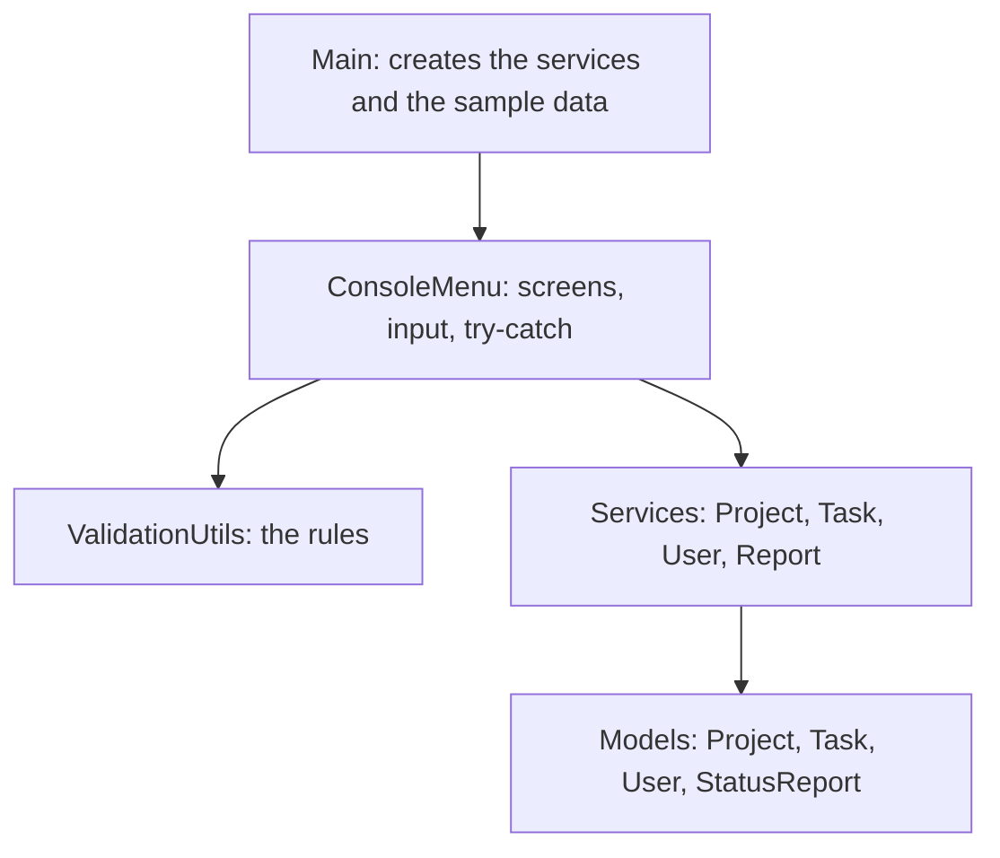
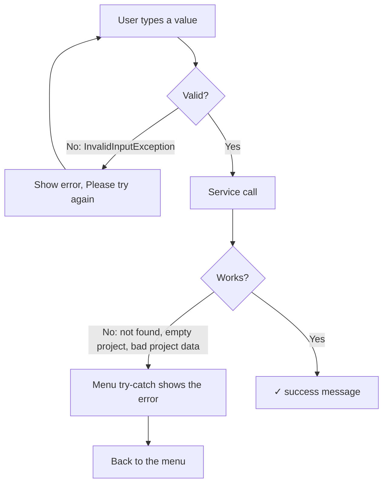

# Design decisions

Why the Lab 2 code looks the way it does, and what I changed from Lab 1.

## Class diagram

- Solid line with a hollow triangle: inheritance (`SoftwareProject` extends `Project`).
- Dashed line with a hollow triangle: interface (`Task` implements `Completable`).
- Filled diamond: a project owns its tasks.
- Plain arrow: one class uses another.

## Layers

- **Models** hold the data and check it. A project with a negative budget cannot be created.
- **Services** do the work: create, find, update, remove, calculate. They don't read the keyboard or print.
- **ValidationUtils** has the rules. Each method returns the value or throws `InvalidInputException`.
- **ConsoleMenu** is the only class that reads the keyboard and prints.

## SOLID

The lab asks for Single Responsibility and Open/Closed.

**Single Responsibility.** Each class has one job:

- In Lab 1, services printed tables and `ConsoleMenu` kept the users. Now services only do the work, `UserService` keeps the users, and printing is in `ConsoleMenu`.
- In Lab 1, `ValidationUtils` both read the keyboard and checked values. Now it only checks values, so it can be tested.

**Open/Closed.** You can add behaviour without changing working code:

- `Project` is abstract. A new kind of project is a new subclass with its own `getType()` and `getProjectDetails()`. The code that prints projects does not change.
- `User` is abstract. Permissions come from `canModify()`, so the menu never checks the role name.

## What I refactored

| Lab 1 | Problem | Lab 2 |
|---|---|---|
| `ValidationUtils` read the keyboard in 8 loops | rules could not be tested | rules only, they throw `InvalidInputException` |
| `findProject` returned `null`, `addTask` returned `false` | the reason for the error was lost | custom exceptions with a clear message |
| services printed tables | services had two jobs | services only do the work, `ConsoleMenu` prints |
| users kept inside `ConsoleMenu` | the menu stored data | `UserService` |
| 0% for a project with no tasks | looked like a real result | `EmptyProjectException`, N/A in the tables |
| `Task.Status.fromText` returned `null` | null checks needed | it throws `InvalidInputException` |
| int IDs with static counters | the lab's test example uses text IDs | text IDs (`PRJ001`) created by the services |

## Exceptions

There are five custom exceptions in `utils/exceptions`. The lab names the first three in its structure and the other two in its features and examples.

| Exception | When |
|---|---|
| `InvalidInputException` | a typed value is wrong |
| `InvalidProjectDataException` | project data is wrong (extends `InvalidInputException`) |
| `ProjectNotFoundException` | no project with that ID |
| `TaskNotFoundException` | no task with that ID |
| `EmptyProjectException` | completion of a project with no tasks |

They extend `RuntimeException`, so they don't need `throws` on every method. This is also what lets the lab's own JUnit example compile as it is written.

- A **typing mistake** (letters, negative hours, unknown status) can be fixed by typing again, so the read methods ask again.
- A **failed operation** (task T999 doesn't exist, negative budget) stops, and the menu comes back. This follows Workflow 2 and the lab's "Operation aborted" example.
- When **choosing a project**, a wrong ID is probably a typo, so it asks again and `0` cancels. This follows the lab's `P999` example.

try / catch / finally:

- the read methods in `ConsoleMenu`: try, catch `InvalidInputException`, ask again;
- each menu loop in `ConsoleMenu`: try the action, catch the custom exceptions, show them, keep the menu running;
- `Main`: try / catch / finally, and `finally` always closes the `Scanner`.

## Arrays

The lab asks for arrays. Projects, tasks and users are kept in arrays, like in Lab 1:

- when an array is full, it is copied into one twice as big (`Arrays.copyOf`), so adding stays fast;
- removing a task moves the next tasks one place to the left, so there are no empty spaces in the middle;
- `getTasks()` and `getProjects()` return a copy, so other classes cannot change the array inside.

## IDs

- Projects get `PRJ001`, tasks `TSK001`, users `U001`. Each service keeps its own counter.
- The counter only goes up after the item is saved, so a failed creation does not skip a number.
- The user can type `PRJ001` or `1`. `ValidationUtils.normalizeId` turns both into `PRJ001`.

## Empty projects

- `calculateCompletionPercentage()` throws `EmptyProjectException` when the project has no tasks.
- The tables check `hasTasks()` first and show N/A.
- The average only counts projects that have tasks. If none have tasks, it throws `EmptyProjectException` and the report shows N/A.

## Tests

- The tests are in `test/`, in the three files of the lab structure. `pom.xml` points Maven to `src/` and `test/`.
- They use `@Test`, `@BeforeEach`, `assertEquals` and `assertThrows`.
- `@BeforeEach` creates new services before each test, so the tests don't affect each other.
- `testCalculateCompletionPercentage` is the example from the lab sheet. `SoftwareProject` and `Task` have short constructors so it compiles as written.

## Next steps

- replace the arrays with collections (Lab 3)
- save the data to files
- add passwords when switching user
